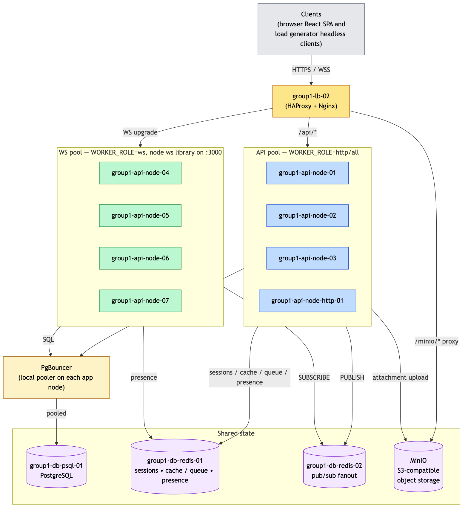

# CSE 356 (Cloud Computing) - Course Project
## Cloud Hosted Real-time Messenging App (Discord-like)
### Authors: Pranav Jothivel, Christopher Brinker, Jacky Chen, and Zach Decena

**Headline:** 3.3K peak concurrent connections at 218.0 msg/s, **~98.4 %** uptime across the 4-week project window (10.7 h cumulative downtime over 672 h).

---

## 1. Project Overview

A cloud-hosted, real-time text messaging service supporting both local accounts and OAuth sign-in (Google, GitHub, and a course-provided OpenID Connect provider), with multi-provider account linking and concurrent sessions across devices. Users organize into communities containing admin-managed public and private channels for persistent group chat, and can also hold direct conversations — one-to-one or as group DMs with their own join/leave semantics and ephemeral lifecycle — outside of any community. Each account carries a profile, avatar, and a presence status (online, idle, away, or offline) derived from connection activity, and can post Unicode messages with up to four image attachments that remain editable and deletable, with every change broadcasting to connected clients in real time. The platform also provides full-text search scoped to a community (honoring per-channel access) or to a direct conversation — filterable by author and time range — and tracks read state and read receipts server-side, so unread counts and receipts stay consistent across all of a user's devices.



The system is composed of:
- **HAProxy + Nginx** at the edge — TLS termination, HTTP/2 ALPN, routing `/api/*` to the API pool, WS upgrades to the WS pool, `/minio/*` to MinIO, and everything else to the React SPA bundle.
- **API pool** (4 nodes, `WORKER_ROLE=http/all`) for REST handlers; **WS pool** (4 nodes, `WORKER_ROLE=ws`) for WebSocket fanout. No sticky sessions; per-worker pub/sub channels route broadcasts only to workers holding recipient sockets.
- **PostgreSQL** (single primary, WAL on NVMe) behind **per-app-node PgBouncer**; **Redis 01** for sessions/cache/queue/presence; **Redis 02** as a dedicated pub/sub bus; **MinIO** for image attachments.

Full topology + design rationale: **[project-docs/ARCHITECTURE.md](project-docs/ARCHITECTURE.md)**.

## 2. Running the System

**Prereqs (local dev):** Node.js 20.x, PostgreSQL 14+, Redis 6+, and any S3-compatible bucket (MinIO works).

**Local quickstart:**
```bash
cd server && npm ci && npm run dev      # backend on :3000
cd client && npm ci && npm run dev      # Vite dev server on :5173
# Apply the schema baseline on first run:
psql "$DATABASE_URL" -f server/scripts/migrations/0007-baseline-schema.sql
```

**Env vars** (server reads from `server/.env` locally; `/srv/app/.env` in prod): `DATABASE_URL`, `REDIS_URL`, `REDIS_PUBLISH_URL`, `SESSION_SECRET`, `FRONTEND_URL`, `MINIO_ACCESS_KEY` / `MINIO_SECRET_KEY` / `MINIO_ENDPOINT`, plus OAuth provider keys for Google / GitHub / OIDC. Full list: **[project-docs/DEPLOYMENT.md](project-docs/DEPLOYMENT.md)**.

**Production deploy:** GitHub Actions, two pipelines — `deploy.yml` (full parallel deploy on `workflow_dispatch`) and `rolling-hot-deploy.yml` (node-by-node drain → deploy → un-drain). LB02 currently requires a manual push; runbook in [`infra/README.md`](infra/README.md). Detail in **[project-docs/DEPLOYMENT.md](project-docs/DEPLOYMENT.md)**.

**Running operations:** PM2 runs the app cluster on each node under the `deploy` user. Common commands:
```bash
sudo -u deploy pm2 list                                  # status
sudo -u deploy pm2 reload ecosystem.config.js            # zero-downtime reload
sudo -u deploy pm2 logs --lines 200                      # tail logs
systemctl reload haproxy                                 # LB config reload
```

**Testing:** No unit-test suite. Verification surface = loadgen runs (archived in [`loadgen-reports/`](loadgen-reports/)), manual smoke through the SPA, TLS-probe script in [`scripts/tls-probe/`](scripts/tls-probe/), HAProxy `/stats`, and Grafana dashboards on the telemetry node.

## 3. Scaling and Load Handling

The journey from default-everything to **3.3K concurrent / 218 msg/s / ~98.4 % uptime across 4 weeks** was a sequence of removing the current binding constraint and watching what became the new one. The main bottlenecks, in the order we hit them:

| # | Bottleneck | Fix | Effect |
|---|---|---|---|
| 1 | PostgreSQL connection pool exhaustion (default Sequelize `max:5`, ~10 504s/sec under burst) | Pool bumped to 20, PgBouncer in transaction mode, dedicated Sequelize search pool | 504 storm eliminated; pool stopped being binding |
| 2 | GIN pending-list flush serializing inserts (3.1 s flush stalls under load) | `ALTER INDEX … SET (fastupdate=off)` | Delivery p95 from 1.5–3 s → 300–700 ms band |
| 3 | `sync({alter:true})` index bloat (182 duplicate `users_username_keyN` indexes) | Disabled `alter` in prod, cleanup script, manual SQL migration workflow | INSERT cost back to baseline; no further drift |
| 4 | Single shared Redis client (HOL blocking; ~7 msg/s/worker ceiling) | Per-purpose Redis clients + dedicated Redis-02 for pub/sub | Each workload independent; unblocked subsequent passes |
| 5 | Pub/sub fanout amplification (more WS subscribers = more publish work) | Three-pass restructure to per-worker pub/sub channels | Fanout cost scales with active receivers, not subscriber count |
| 6 | WS broadcast payload size & hot-path cost (per-`deliverLocal` JSON.stringify; api-only nodes iterating empty `users` Map) | Pre-stringify at publisher, skip `deliverLocal` on api-only workers, chunk per-user fanout, debounce per-user `broadcastPresenceChange` | Per-publish event-loop cost on WS workers down substantially; api-only CPU stops spiking on broadcasts |
| 7 | Redis RDB BGSAVE forks (53 s saves, ~100 ms fork pauses per minute) | Disabled RDB on Redis-01 (state rebuildable from PG) | Periodic latency artifacts gone |
| 8 | HAProxy single-thread + tight maxconn | `nbthread 4→16`, `maxconn 8192→32768`, HTTP/2 ALPN, `tune.ssl.lifetime`, second LB with BBR sysctl tune | HAProxy CPU 80% → 25%; cold p99 638 → ~400 ms |
| 9 | Monolith worker (REST + WS on the same event loop) | `WORKER_ROLE` split: `http` / `ws` / `all` per node | WS event loops free of REST stalls; api-only workers skip pub/sub fanout |

The remaining limitations (dual-table FTS, read replica, lb02-in-pipeline, AOF on Redis-01, integration tests) are listed honestly in the detail doc.

**Full analysis with evidence, per-bottleneck Problem → Evidence → Fix → Effect → Tradeoff format: [project-docs/SCALING.md](project-docs/SCALING.md).**

## 4. Design Decisions

Brief; each has a paragraph in [project-docs/ARCHITECTURE.md](project-docs/ARCHITECTURE.md#design-decisions).

- **Two Redis instances** (sessions/cache/presence on `:6379`, pub/sub on `:6380`) — keeps fanout traffic from competing with read-modify-write presence on a shared event loop.
- **PgBouncer in transaction mode** on each app node — multiplexes worker connections onto a small number of real Postgres connections; we don't use any session-scoped feature it would break.
- **No sticky sessions** — all shared state lives in Redis-01 or Redis-02; HAProxy uses `leastconn` for both REST and WS, freely round-robining.
- **Per-worker pub/sub channels** — broadcasts only target workers that actually hold a recipient socket; adding subscribers no longer makes publishing more expensive.
- **`WORKER_ROLE` split** (`http`/`ws`/`all`) — pins WS work to dedicated nodes and lets API nodes skip pub/sub fanout entirely.
- **PostgreSQL FTS over Elasticsearch** — at our scale, GIN-indexed FTS is plenty and avoids a second stateful service.
- **MinIO over NFS** — S3-compatible API is a more stable abstraction; LB-side Nginx serves `/minio/*` to clients without involving app nodes.
- **Distributed mutex on presence** — read-modify-write of the user's presence body is held under a per-user lock to avoid lost updates.
- **Bcrypt cost 10** (lowered from 12 after a measurable load-test impact on login latency).
- **All routes under `/api/*`** — HAProxy can route by path prefix unambiguously; WS upgrades are detected by `hdr(Upgrade) -i websocket`, not by path.
- **Schema discipline** — production runs `sync()` *without* `alter`; schema changes go through numbered SQL files in `server/scripts/migrations/`.

## 5. Developer Guide

Detail in **[project-docs/DEVELOPER-GUIDE.md](project-docs/DEVELOPER-GUIDE.md)**. The bird's-eye view:

```
client/   ← React SPA (Vite + TS)
server/
  src/
    app.js         ← entry, middleware, route mounts
    ws.js          ← WebSocket server + per-worker pub/sub fanout
    redis.js       ← per-purpose Redis clients
    routes/        ← REST handlers (one file per resource)
    models/        ← Sequelize models
  scripts/migrations/   ← numbered SQL migrations (0007-baseline-schema.sql is current)
  ecosystem.config.js   ← PM2 cluster config
infra/
  nodes.yml             ← node inventory, read by deploy pipeline
  haproxy/, nginx/, pgbouncer/, lb-sysctl-heavy.conf
project-docs/           ← public-facing docs (this folder)
claude-docs/            ← raw session notes (source for project-docs/)
loadgen-reports/        ← archived loadgen run outputs
.github/workflows/      ← deploy.yml + rolling-hot-deploy.yml
```

To add a feature, run tests, or debug something that's been seen before — see the corresponding section in **[project-docs/DEVELOPER-GUIDE.md](project-docs/DEVELOPER-GUIDE.md)**.

## 6. Team Process and Contributions

| Member | Primary responsibility |
|---|---|
| **Pranav Jothivel** | Infrastructure / CI/CD / LB config / observability / incident response / sustained perf tuning |
| **Christopher Brinker** | WS layer (presence, broadcast perf, dead-connection handling), MinIO infra, metrics, Redis mutex behavior |
| **Jacky Chen** | Authentication (local + OAuth), search, attachment system, message-send hot path, HAProxy CPU tuning |
| **Zach Decena** | Direct conversations (DMs + group DMs), messaging/presence optimization, issue tracking, vertical + horizontal node scaling |

**Communication & process** — primary channel is the team Discord, with Sentry, Grafana Cloud, and Axiom alerts piped into the same server. GitHub PRs are the unit of code review. Work was claim-based (whoever had the most context volunteered) rather than top-down assigned. Deadlines were tracked against the course ranking — each ranking snapshot reset the priority queue around "what's the binding constraint now."

**Full per-member contribution detail with commit citations: [project-docs/TEAM.md](project-docs/TEAM.md).**

---

## Document index

| Section | Detail file |
|---|---|
| Architecture & design decisions | [project-docs/ARCHITECTURE.md](project-docs/ARCHITECTURE.md) |
| Deploying & running | [project-docs/DEPLOYMENT.md](project-docs/DEPLOYMENT.md) |
| Scaling analysis (per-bottleneck) | [project-docs/SCALING.md](project-docs/SCALING.md) |
| Developer guide | [project-docs/DEVELOPER-GUIDE.md](project-docs/DEVELOPER-GUIDE.md) |
| Team contributions | [project-docs/TEAM.md](project-docs/TEAM.md) |
| Infrastructure runbook | [infra/README.md](infra/README.md) |
| Architecture diagram source | [project-docs/diagrams/architecture.mmd](project-docs/diagrams/architecture.mmd) |
