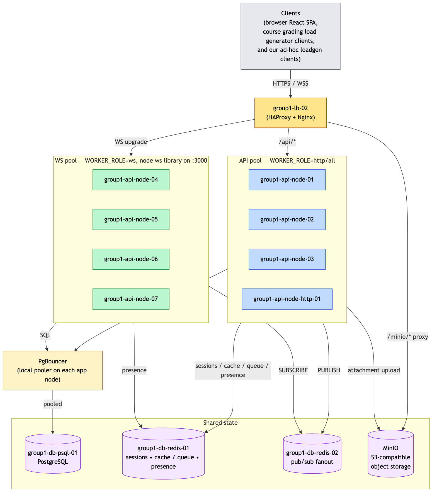

# Architecture & Design Decisions

This document describes the system at the topology level and the rationale behind the major technical choices. For the optimization journey that shaped these choices, see [SCALING.md](SCALING.md).

## System diagram

Source: [`diagrams/architecture.mmd`](diagrams/architecture.mmd) (mermaid).

## Components

| Component | Role |
|---|---|
| **Clients** | The React SPA served from the LB, plus two distinct populations of headless API-driven clients: the **course grading load generator's** simulated end-users (running continuously throughout the Test Traffic Period) and **our own ad-hoc loadgen** runs that we drove against the cluster from a developer laptop / the loadgen node during tuning passes. All three populations speak HTTPS for REST and WSS for the realtime channel. |
| **HAProxy + Nginx (`group1-lb-02`)** | TLS termination, HTTP/2 ALPN, routing (`/api/*` → API pool, WS upgrade → WS pool, `/minio/*` → MinIO, everything else → Nginx-served SPA). Heavy TCP tune (BBR, `infra/lb-sysctl-heavy.conf`). A second LB (`group1-web-lb01`) exists historically but is being phased out — current diagrams show only `lb-02`. |
| **API pool** | Stateless Node workers with `WORKER_ROLE=http` or `all`: serve REST endpoints, publish broadcasts onto Redis-02, write/read Postgres and Redis-01. Members: `group1-api-node-01/02/03/http-01`. |
| **WS pool** | Node workers with `WORKER_ROLE=ws`: hold WebSocket connections, subscribe to per-worker pub/sub channels on Redis-02, deliver broadcasts locally. Members: `group1-api-node-04/05/06/07`. Uses the `ws` library on port `:3000` alongside the local Express HTTP server. |
| **PgBouncer (per app node)** | Local transaction-pooling proxy in front of Postgres. App processes connect to `127.0.0.1:6432`; PgBouncer multiplexes onto a small number of real Postgres connections. |
| **PostgreSQL (`group1-db-psql-01`)** | Primary data store. WAL on a dedicated NVMe block volume. Single write node — no replication today. Schema captured in `server/scripts/migrations/0007-baseline-schema.sql`. |
| **Redis 01 (`group1-db-redis-01`, `:6379`)** | Sessions (`connect-redis`), application caches (channel members, message bodies, unread counts), presence state, and the distributed mutex on presence updates. RDB persistence is disabled — every piece of state on this instance is rebuildable. |
| **Redis 02 (`group1-db-redis-02`, `:6380`)** | Dedicated pub/sub instance for cross-node WebSocket broadcast fanout. Per-worker channels — each WS worker subscribes only to traffic it can deliver. |
| **MinIO** | S3-compatible object storage for image attachments. App nodes use the S3 SDK for uploads; clients fetch via the LB's `/minio/*` proxy (Nginx → MinIO). |

## Request flow (REST)

1. Client → HAProxy on `:443` (TLS terminate, ALPN HTTP/2).
2. HAProxy ACL routes `/api/*` to the API pool with `leastconn` balancing.
3. API worker authenticates via session cookie → looks up session in Redis-01 → `passport.deserializeUser` hits the user cache (60s TTL) before falling back to Postgres.
4. Handler runs business logic, talks to Postgres via local PgBouncer and Redis-01 for cached members / unread state.
5. For writes that broadcast, the response is returned *before* the broadcast publishes — the publish happens post-response, async (`#164`).

## Request flow (WebSocket message broadcast)

1. Client → HAProxy `:443` → WS pool, balanced `leastconn`. No sticky sessions.
2. After WS open, the server runs init (JWT verify, `User.findByPk`, Redis lock acquisition, presence update, register in `users` map) and sends a raw `"ready"` frame. Clients **must** await `"ready"` before sending messages (otherwise broadcasts can fire while the receiver isn't yet in the delivery map).
3. When `POST /api/messages` lands on an API worker, that worker (a) writes the message to Postgres, (b) returns the HTTP response, and (c) publishes the broadcast event to the per-worker channels of the WS workers that hold any recipient socket. Recipient → worker mapping is maintained in Redis-01 presence state.
4. Each receiving WS worker reads its channel, looks up the local sockets for the recipient set, and writes the frame.

## Design decisions

### Why HAProxy + Nginx instead of just one

HAProxy does L4/L7 routing and TLS termination; Nginx serves the static React bundle and proxies `/minio/*`. HAProxy doesn't serve files well; Nginx doesn't multiplex backends as efficiently. Co-locating both on the LB box gives us each tool's strength and shares the kernel TCP tune.

### Why two Redis instances

The first instance (`:6379`) carries sessions, caches, presence, and the mutex. It was originally a single point of contention for every kind of Redis operation (see SCALING.md, Bottleneck 4). The second instance (`:6380`) carries *only* cross-node WS broadcast pub/sub. Splitting fanout off keeps the high-volume publish/subscribe traffic from contending with the read-modify-write presence path. Different physical Redis processes also means different `redis-server` event loops — true parallelism, not just different clients.

### Why PgBouncer in transaction mode

Sequelize keeps a per-worker connection pool. With dozens of workers cluster-wide, the *application's* connection count alone could exceed Postgres's `max_connections`. PgBouncer in transaction mode multiplexes app connections onto a small number of real Postgres connections — a single transaction is the unit of association. We don't use `SET LOCAL`, advisory locks, or session-scoped prepared statements (the things transaction mode breaks), so the trade is clean.

### Why no sticky sessions

Sessions live in Redis-01, presence lives in Redis-01, and cross-node broadcast lives on Redis-02. There is no per-node state that would benefit from sticky routing. HAProxy uses `leastconn` and round-robins both REST and WS traffic freely. A WS client on `api-node-04` still receives messages published from a handler that ran on `api-node-02` — the broadcast went through Redis-02.

### Why per-worker pub/sub channels (instead of one shared `messages` channel)

The original design used a single `messages` channel that every WS worker subscribed to. Every WS worker received every broadcast (including ones with no local recipients) and paid the deserialization cost of ~180 KB payloads. As we scaled out the WS pool, **adding subscribers made publishing strictly more expensive** — the opposite of what we wanted. The per-worker channel scheme (PR #s `d2059f4` / `a82eba6` / `c16280b`) routes each broadcast only to workers that actually hold a recipient socket, so fanout cost scales with active receivers rather than total subscribers.

### Why split `WORKER_ROLE` into `http` / `ws` / `all`

A monolithic worker pays the cost of WS pub/sub deserialization (~180 KB per broadcast) even when it holds zero sockets, and a heavy REST handler can stall the WS event loop on the same worker. The role split (`c4faf80`) pins WS work to dedicated nodes and lets API nodes skip the pub/sub subscriber entirely. The `http`-only role on `api-node-http-01` was the latest step — it doesn't even initialize the WS server, just REST + Express health check.

### Why PostgreSQL FTS instead of Elasticsearch

At our scale (single-digit-million messages by end of project), Postgres FTS with a GIN index is plenty, and avoids running a second stateful service. We did pay the cost of fighting GIN's `fastupdate` behavior (see SCALING.md, Bottleneck 2) — `fastupdate=off` was a real fix.

### Why MinIO instead of NFS

The early plan was an NFS mount. We switched to MinIO because:
- S3-compatible API is a stable abstraction (clients are SDK-based, not filesystem-bound).
- MinIO can be scaled / replicated independently of the app nodes.
- LB serves `/minio/*` to clients via Nginx proxy without app-node involvement, just like NFS would have.

### Why a distributed mutex on presence

Presence is a read-modify-write hash: read the user's presence body, mutate a field, write it back. Without a lock, two concurrent connections could fight (e.g. a "set away" racing with a connection-count increment), and the lost update would silently corrupt presence. The mutex on `users:{id}` is held only across the 5 Redis round-trips of one update — small blast radius — and uses `simple-redis-mutex` (`PUBLISH`-based release notification). Chris owned this layer.

### Authentication choices

- **Local accounts** — bcrypt at cost 10 (lowered from default 12 after a load-test showed login latency dominated by hash cost — `8f422b5`).
- **OAuth providers** — Google, GitHub, and the course Keycloak via OIDC discovery. Strategies in `server/src/auth/passport.js`.
- **Multi-provider linking** — `User.providers` is a JSONB array; a user can sign in via any linked provider and end up in the same account. OAuth flows that land on a known email surface a "link or create" page via `req.session.pendingOAuth`.
- **Per-session logout** — each login is its own session row in Redis-01; logging out of one doesn't affect others.

### API design

- All backend routes under `/api/*` so HAProxy can route by path prefix without ambiguity.
- WebSocket upgrade detected by `hdr(Upgrade) -i websocket`, not by path — the WS URL begins with `/api/?token=…` and would match the `is_api` ACL otherwise.
- 4xx for client errors (validation, not-a-member), 5xx for unexpected server failures only. We added `option redispatch` + `retry-on all-retryable-errors 503` at HAProxy so transient backend 503s during a rolling deploy never reach the client.

### Fault tolerance / retry behavior

- **HAProxy `option redispatch`** + `retry-on all-retryable-errors 503` — backend 503s are retried on a different node automatically.
- **Health checks** — `option httpchk GET /` on both API and WS backends. WS backend health-checks the *Express* port (`:3000`) which doubles as a readiness signal that the WS server is up.
- **OIDC startup is fire-and-forget** — `setupOidcStrategy().catch(...)` so a Keycloak-unreachable error at boot doesn't crash the PM2 worker into a restart loop. OIDC is degraded-but-optional; the rest of the app should come up.
- **Sessions are persistent in Redis-01** (with no RDB save, but Redis itself almost never restarts under normal operation). A Redis-01 restart is an explicit session-loss event we've accepted.

### Concurrency model

Single-threaded Node.js per PM2 worker; many workers per node (PM2 cluster mode, one worker per vCPU). All coordination happens out-of-process via Redis. No worker-to-worker IPC.

### Schema management

Production runs `sequelize.sync()` *without* `alter` (deliberately — `alter:true` accumulated 182 duplicate unique indexes; see SCALING.md, Bottleneck 3). Schema changes go through hand-applied numbered SQL files under `server/scripts/migrations/`. The current production baseline is captured as `0007-baseline-schema.sql`.

## Deployment topology summary

| Tier | Nodes | Purpose |
|---|---|---|
| LB | `group1-web-lb01`, `group1-lb-02` | TLS, routing, static SPA, MinIO proxy. lb-02 is the active node. |
| API pool | `group1-api-node-{01,02,03,http-01}` | REST handlers (`WORKER_ROLE=http`/`all`). |
| WS pool | `group1-api-node-{04,05,06,07}` | WebSocket fanout (`WORKER_ROLE=ws`). |
| DB | `group1-db-psql-01` | Postgres (single primary). |
| Redis-01 | `group1-db-redis-01` | Sessions, cache, presence, mutex. |
| Redis-02 | `group1-db-redis-02` | Pub/sub fanout only. |
| Object store | MinIO (currently colocated on `lb01`) | Attachments. |
| Telemetry | `group1-telemetry-01` | Grafana Alloy receiver — aggregates logs + metrics from every node and **forwards to Grafana Cloud** (Loki for logs, Prometheus/Mimir for metrics, hosted Grafana dashboards). HAProxy access logs additionally stream to Axiom via Vector for live tail during incidents. **Sentry** captures any unhandled exception thrown by an app worker, with the stack trace and request context, so errors that don't bubble up as a non-2xx response are still surfaced — currently disabled in the live codepath after a perf/value tradeoff but the integration is in place. |

Full IP and sizing details in [`infra/README.md`](../infra/README.md) and [`infra/nodes.yml`](../infra/nodes.yml).
